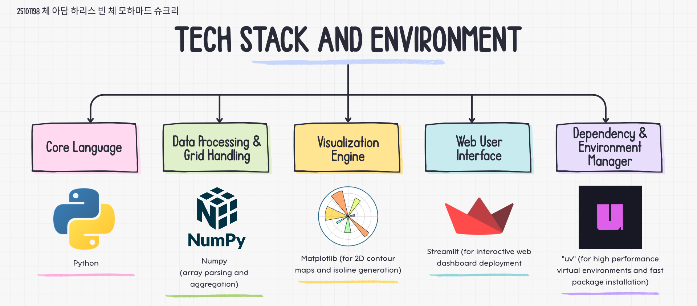
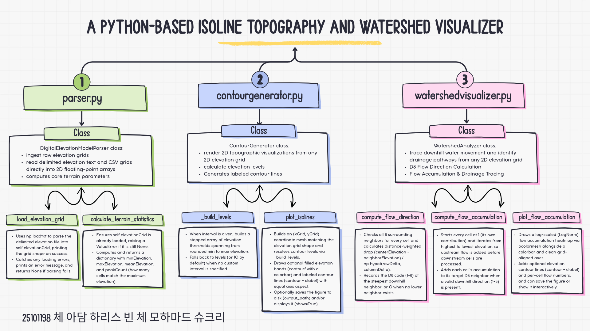
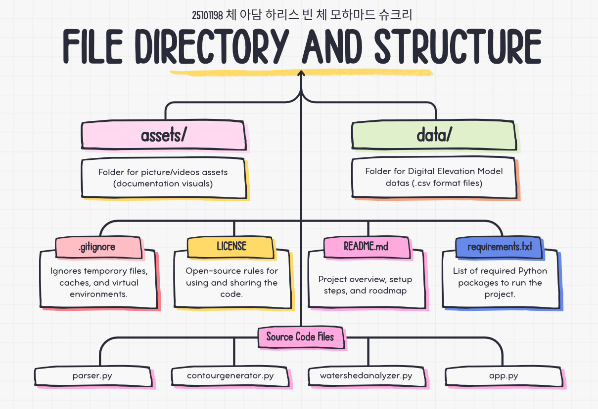
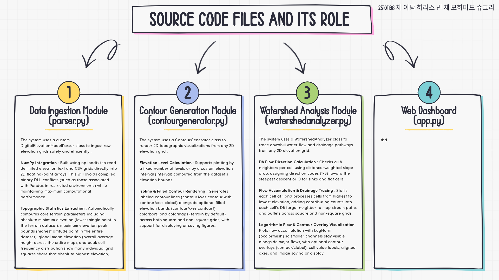
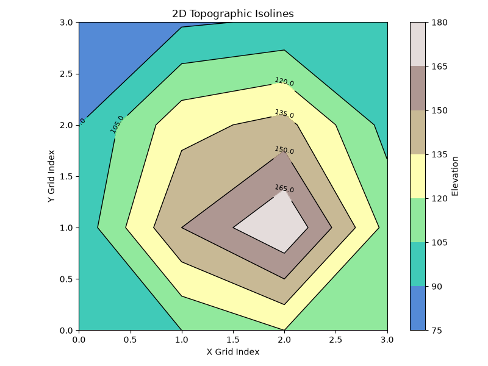
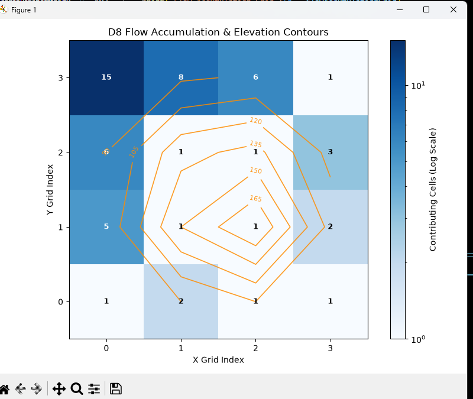
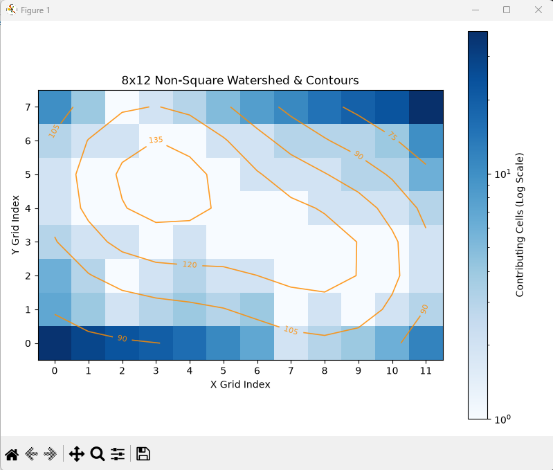

# A Python-based Isoline Topography and Watershed Visualizer

An open-source Python web application designed for processing Digital Elevation Models (DEM) data, generating topographic isolines (or contour lines), and trace regional watersheds (or hydrological drainage paths).

## Project Overview
Topographic mapping and hydrological analysis are fundamental pillars of geographic information systems (GIS). Understanding how land is shaped and how water flows across hills and valleys is usually done using expensive, complicated professional software (e.g. Proprietary GIS Software). This project is a lightweight, interactive web tool that lets users load elevation grids data, measure the landscape, and view land shapes clearly on their screen without needing any heavy mapping programs.

## Project Development Roadmap
**[DONE on 11.15!] Phase 1 [parser.py]: Core Data Ingestion & Architecture**
- Build DigitalElevationModelParser class with pure NumPy grid loading and statistical summaries.
- Establish version control workflow and project repository structure.

**[DONE on 11.22!] Phase 2 [contourgenerator.py]: 2D Isoline & Contour Generation**
Implement Matplotlib contour mapping algorithms to render topographic height lines.

**[DONE on 11.27!] Phase 3 [watershedanalyzer.py]: Watershed Tracing Logic**
Compute flow direction matrices and accumulation grids to trace drainage basins.

**[] Phase 4: Streamlit Web Dashboard UI**
Build an interactive web frontend allowing users to upload custom DEM files and adjust contour intervals in real time.

## Tech Stack & Environment


## Project Classes & Methods


## File Directory & Structure


## Source Code Files and Its Roles


## Phase 2: 2D Topographic Isolines Output (Sample Data)

.png)

## Phase 3: Flow Accumulation and Elevation Contours Output (Sample Data)



## Getting Started 
Set up the environment and run modules with uv or standard Python :

```text
uv venv
uv pip install -r requirements.txt
uv run python watershedanalyzer.py
```

## License
This project is open-source and available under the terms of the MIT License.